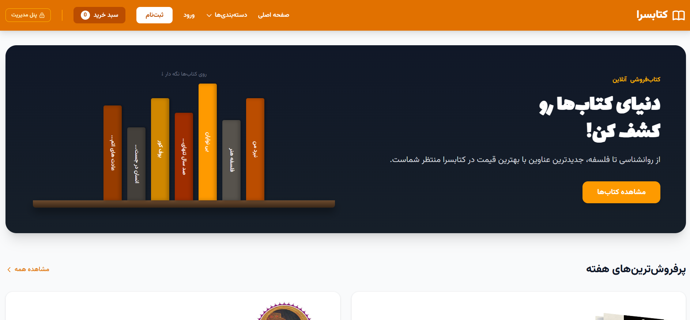
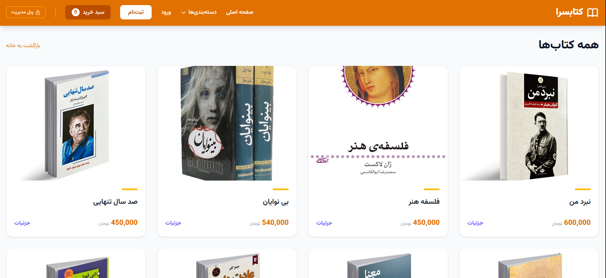
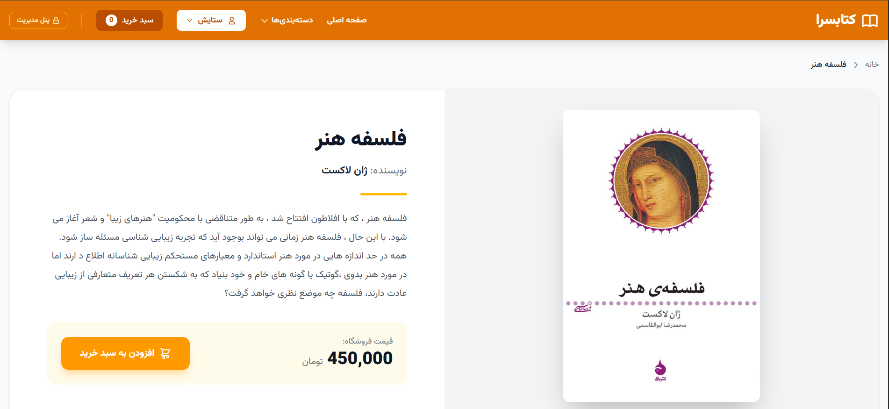
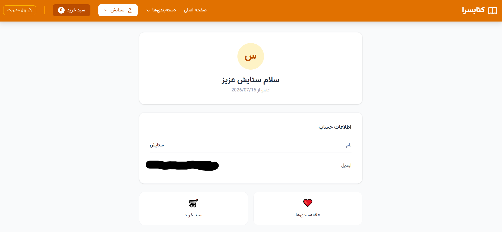
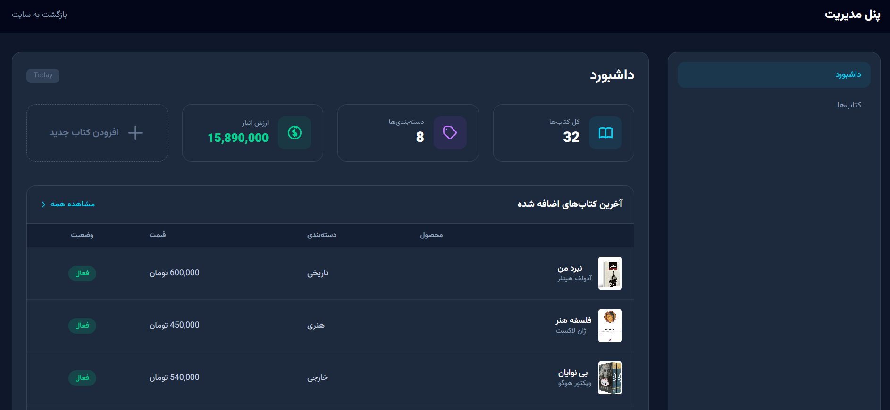

# KetabSera — Laravel Book Store

A Persian online bookstore built with Laravel, featuring user authentication, a shopping cart, a favorites system, a user dashboard, and an admin panel for book management.

## Screenshots

### Homepage


### Book Catalog


### Book Details


### User Dashboard


### Admin Dashboard


## Features

### User Features
- User registration and login
- Browse books and view book details
- View book prices and descriptions
- Add books to the shopping cart
- View the cart and calculate the total price
- Add books to favorites
- Access a personal dashboard
- View personal information, including name and email
- Access the shopping cart and favorites from the user dashboard

### Admin Features
- Access the admin dashboard
- Add new books
- Edit existing book information
- Delete books
- View the total number of books
- View the total inventory value
- View recently added books

## Technologies

- PHP
- Laravel
- MySQL
- Blade
- Tailwind CSS
- HTML
- CSS

## Getting Started

### Prerequisites

- PHP and Composer
- MySQL
- Node.js and npm (for frontend dependencies and assets)

### 1. Clone the repository

```bash
git clone https://github.com/shsetayeshh/BookStore-Laravel.git
cd BookStore-Laravel
```

### 2. Install PHP dependencies

```bash
composer install
```

### 3. Install frontend dependencies

```bash
npm install
```

### 4. Configure the environment

Create your local environment file by copying `.env.example`:

**Windows (Command Prompt):**
```bat
copy .env.example .env
```

**macOS/Linux:**
```bash
cp .env.example .env
```

Generate the application key:

```bash
php artisan key:generate
```

### 5. Configure the database

Create a MySQL database and update the relevant settings in your `.env` file:

```env
DB_CONNECTION=mysql
DB_HOST=127.0.0.1
DB_PORT=3306
DB_DATABASE=your_database_name
DB_USERNAME=your_username
DB_PASSWORD=your_password
```

### 6. Run database migrations

```bash
php artisan migrate
```

### 7. Run the application

Start the Laravel development server:

```bash
php artisan serve
```

In a separate terminal, run the frontend development server:

```bash
npm run dev
```

Open the local URL shown by Laravel, usually:

http://127.0.0.1:8000

**Note:** Database seeders, if required, must be run separately. The application may require additional configuration depending on the local environment.

## Demo

A live demo is not currently available. Screenshots are provided to showcase the application's interface and features.

## Author

**Setayesh Shiekhi**

GitHub: [shsetayeshh](https://github.com/shsetayeshh)